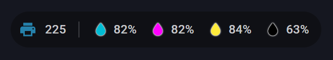
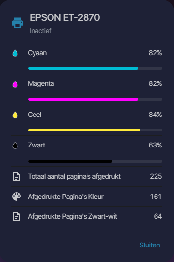

# Printer Badge


<!-- ha-marketplace:exclude-start -->
[](https://my.home-assistant.io/redirect/marketplace_repository/?owner=LeonCB&repository=Printer-Badge&category=plugin)
<!-- ha-marketplace:exclude-end -->

Eén Home Assistant-badge voor je printer: status, pagina-teller en
inktniveaus, met alle details in een pop-up als je erop tikt. Vervangt een
rij losse badges.

<p align="center"></p>

- Printericoon: stand-by in je primaire kleur, **pulserend geel** tijdens
  printen, **rood** bij een fout of als de printer niet bereikbaar is
- Pagina-teller
- Per inktkleur een gekleurde druppel met een dun wit randje en het
  percentage; onder de grens (standaard 20%) wordt het percentage **rood**
  en licht het randje van de druppel **rood op**
- Tik: pop-up met status, inktniveaus met balkjes, pagina-teller en
  eventuele extra sensoren

<p align="center"></p>

## Installatie

<!-- ha-marketplace:exclude-start -->
### Marketplace (Home Assistant 2026.11 en nieuwer)

[](https://my.home-assistant.io/redirect/marketplace_repository/?owner=LeonCB&repository=Printer-Badge&category=plugin)

1. Klik op de knop hierboven, of ga naar **Instellingen → Marketplace → ⋮ →
   Add from link** en vul `https://github.com/LeonCB/Printer-Badge` in,
   categorie **Dashboard**. Voor een eigen repository moet in de Marketplace
   een GitHub-account gekoppeld zijn.
2. Installeer **Printer Badge**. De Marketplace registreert de
   dashboard-resource zelf.
<!-- ha-marketplace:exclude-end -->

### Handmatig

1. Kopieer `printer-badge.js` naar `<config>/www/`
2. **Instellingen → Dashboards → ⋮ → Bronnen → Bron toevoegen**,
   URL `/local/printer-badge.js`, type **JavaScript-module**

Daarna: dashboard bewerken → **Badge toevoegen** → zoek "Printer"

## Configuratie

Alles is in te stellen in de visuele editor.

```yaml
type: custom:printer-badge
entity: sensor.epson_et_2870
pages: sensor.epson_et_2870_totaal_paginas
details:
  - sensor.epson_ecotank_et_2870_afgedrukte_pagina_s_kleur
  - sensor.epson_ecotank_et_2870_afgedrukte_pagina_s_zwart_wit
```

| Optie | Standaard | Omschrijving |
|---|---|---|
| `entity` | — | **Verplicht.** Statussensor van de printer (bijv. van de IPP-integratie) |
| `inks` | automatisch | Inktsensoren. Leeg: de %-sensoren van hetzelfde apparaat met cyaan/magenta/geel/zwart in de naam |
| `pages` | automatisch | Pagina-teller. Leeg: een sensor op hetzelfde apparaat met "totaal" en "pagina's" in de naam. `false` = geen teller |
| `details` | — | Extra sensoren die alleen in de pop-up staan |
| `low_threshold` | `20` | Onder dit percentage wordt een inktniveau rood |
| `name` | apparaatnaam | Titel in de pop-up |
| `icon` | `mdi:printer` | Printericoon |

De kleur van een inkt volgt uit de naam (cyaan/cyan, magenta, geel/yellow,
zwart/black, ook Duits en Frans). Een eigen kleur zet je in YAML:

```yaml
inks:
  - sensor.printer_cyaan
  - entity: sensor.printer_foto_zwart
    color: "#555"
```

Status- en inktsensoren komen meestal van de IPP-integratie. Komt de
pagina-teller van een andere integratie (bijvoorbeeld SNMP), dan staat die
op een ander apparaat en kies je hem zelf bij **Pagina-teller**.

## Thema-variabelen

Allemaal optioneel; zonder variabelen volgt de badge je Home
Assistant-thema.

| Thema-variabele | Standaard |
|---|---|
| `printer-badge-icon-color` | `var(--primary-color)` |
| `printer-badge-printing-color` | `var(--yellow-color)` |
| `printer-badge-error-color` | `var(--red-color)` |
| `printer-badge-low-color` | `var(--red-color)` (percentage en gloed bij bijna leeg) |

## Toegankelijkheid

De badge heeft een beschrijvend label voor schermlezers (naam, status,
pagina's en inktniveaus) en is met het toetsenbord te openen. Het pulseren
van het printericoon en de rode gloed staan uit bij "minder beweging" in je
systeem; het rode percentage blijft dan zichtbaar.

## Licentie

MIT — zie [LICENSE](LICENSE).
